<div align="center">

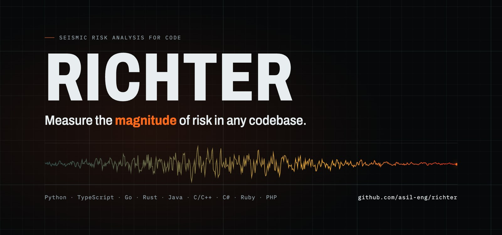

### Every codebase has a few files that can take everything down with them.<br>Richter finds them *before* you touch them.

<sub><b>Devin Hacks Kochi · Track 2: Make the Invisible Visible</b> — it reveals risk nobody can see in the code, then tells you what to do about it.</sub>

<a href="https://asil-eng.github.io/richter/app/"></a>
<a href="https://asil-eng.github.io/richter/"></a>
<a href="#-languages"></a>
<a href="backend/tests"></a>

</div>

<br>

<table>
<tr>
<td align="center" width="25%"><h2>88 files</h2><sub>downstream of <b>one</b> file in <a href="https://github.com/Textualize/rich">rich</a>: change <code>cells.py</code> and 81% of the codebase feels it</sub></td>
<td align="center" width="25%"><h2>17×</h2><sub>fastapi's <code>security/*</code> modules changed together, without ever importing each other</sub></td>
<td align="center" width="25%"><h2>181</h2><sub>towers light up when you click hugo's <code>template.go</code> in the <a href="#6--your-codebase-as-a-city-click-a-building-watch-the-shock-spread">code city</a></sub></td>
<td align="center" width="25%"><h2>0 installs</h2><sub>to try it: the <a href="https://asil-eng.github.io/richter/app/">live demo</a> runs entirely in your browser</sub></td>
</tr>
</table>

## ⚡ Try it now

| | | |
| --- | --- | --- |
| 🌐 | **[Open the live app](https://asil-eng.github.io/richter/app/)** | Seven real repos (rich, fastapi, black, ripgrep, plus the larger excalidraw, hugo and textual), interactive, nothing to install |
| ▶ | **[Watch the 2½-minute demo](https://asil-eng.github.io/richter/)** | The whole story with narration |
| 💻 | **[Analyze your own repo](#-analyze-any-github-repo)** | Run it locally, paste any public GitHub repo link, get its risk map |

[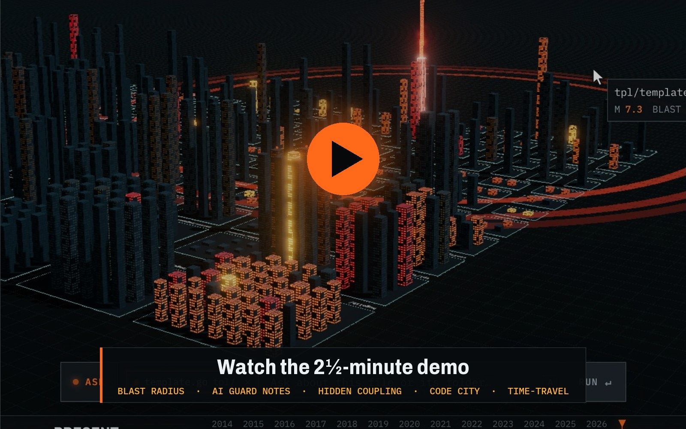](https://asil-eng.github.io/richter/)

<sub>Click to play · narration is AI-generated (ElevenLabs)</sub>

<!-- To show an inline player instead: edit this README on github.com, drag docs/richter-demo.mp4 here, and delete the thumbnail link above. -->

<details>
<summary><b>🧭 The 60-second tour (for judges)</b></summary>

<br>

Open the **[live app](https://asil-eng.github.io/richter/app/)**, then:

1. **Read the map.** Textualize/rich loads as a seismic hazard map. The orange contours mark where risk concentrates.
2. **Pick an epicenter.** In the right panel under *START HERE*, click **MOST DANGEROUS · console.py**. Watch the blast radius ripple out, and read the plain-English summary, the gauge and the danger-zone plot.
3. **Read the AI note.** Scroll the right panel to **GUARD NOTE / UNBLOCK PLAN**: what breaks, why, and what to check before merging.
4. **Ask the repo.** Press `A` and pick ⚡ *Which files are most fragile?* The answer highlights the files on the map.
5. **Find hidden coupling.** Press `Esc`, scroll the left panel to **LAYERS**, and switch on **GHOST EDGES**.
6. **Travel in time.** Press `3` for the code city and drag the timeline at the bottom: seven years of history.
7. **Change language.** Press `/`, type `ripgrep`, and press Enter: a Rust codebase, same instruments.

</details>

---

## The problem

You're about to change a file. What else breaks? Is this the file that gets "fixed" every other week? Is it secretly tied to a file it never imports? On a large codebase nobody can hold all of that in their head, and the tools we have show the *structure* of code, not the *risk* in it.

**Richter reads two things that rarely meet in one view:**

| | Signal | Where it comes from |
| --- | --- | --- |
| 🏗 | **Structural risk:** what depends on this file | the import graph, followed *transitively* |
| 🔧 | **Human risk:** how often this file gets reworked | the full git history: churn, fix commits, authors |

It fuses them into one **magnitude** from 0 to 10, like an earthquake. Files high on *both* axes are the ones that hurt.

---

## What you get

### 1 · A seismic hazard map, not another dependency graph

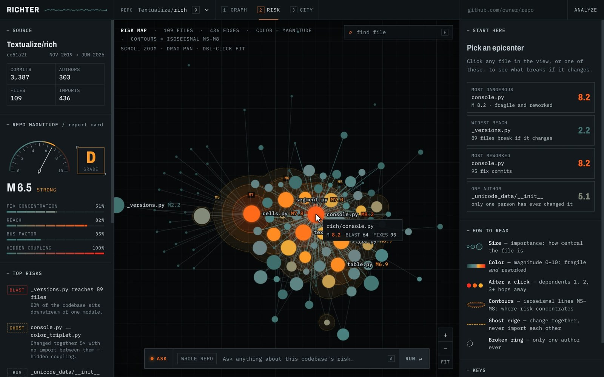

Every file is a node: size is how central it is, color is its magnitude. Risk spreads into **isoseismal contours** at M5, M6, M7 and M8, like a quake map, so the danger zones stand out before you click anything. The riskiest files pulse with aftershocks and show their scores. Above, [Textualize/rich](https://github.com/Textualize/rich): `console.py` (M 8.2), `cells.py` (M 7.8) and `text.py` (M 7.5) form the epicenter.

### 2 · Blast radius: who breaks if you change this

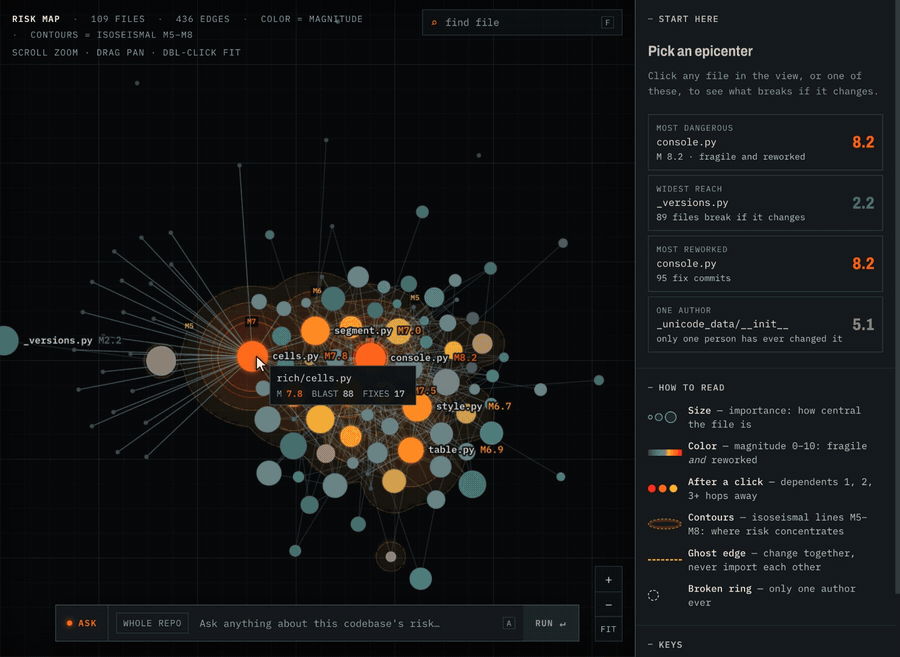

Click a file and Richter follows the imports **backwards through the whole graph**: everything that imports it, everything that imports *those*, and so on. The shock travels along the real import edges, ring by ring: **hop 1** in red, **hop 2** in orange, **hop 3+** in amber. Change `rich/cells.py` and **88 files, 81% of the codebase**, are downstream.

### 3 · An inspector that explains, not just measures

<table>
<tr>
<td width="50%">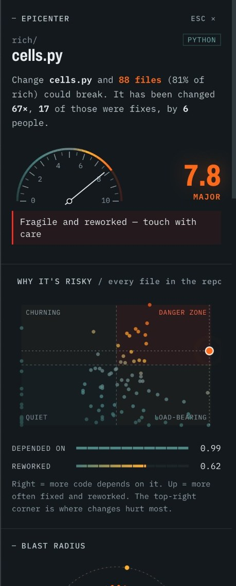</td>
<td width="50%">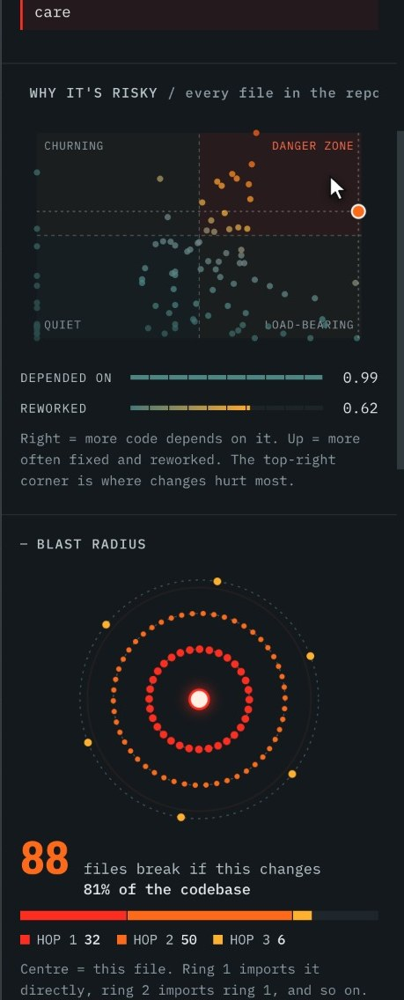</td>
</tr>
<tr>
<td><b>A sentence first.</b> "Change cells.py and 88 files (81% of rich) could break. It has been changed 67×, 17 of those were fixes, by 6 people." Then a gauge and a verdict: <i>fragile and reworked: touch with care.</i></td>
<td><b>Why it's risky.</b> Every file in the repo plotted by <i>depended on</i> × <i>reworked</i>. This file pulses in the <b>danger zone</b>. Below, the blast radius is drawn as shockwave rings: click any dot to jump to that file.</td>
</tr>
</table>

### 4 · Ask the repo, about what you're looking at

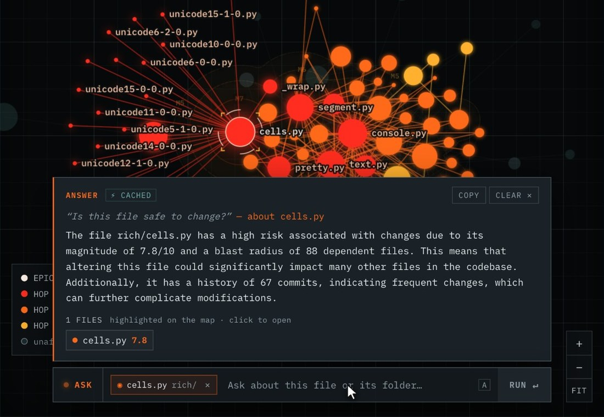

Ask in plain English. The ask bar knows your selection (the `◉ cells.py rich/` chip), so *"is this file safe to change?"* is answered about that file and its folder. Answers come from the risk model (`gpt-4o-mini`). Every file path the model returns is **checked against the real repo before anything is highlighted**, and invented paths are dropped.

For any file, Richter also writes a **guard note** (*what breaks and why, a checklist before you merge*) and an **unblock plan** (*why it keeps getting reworked, how to fix that*). These are notes for humans, not generated code.

### 5 · Hidden coupling: files that move together but never import each other


Dashed **ghost edges** connect files that are repeatedly committed together with no import between them: coupling the code doesn't declare. In [fastapi](https://github.com/fastapi/fastapi), the `security/*` modules changed together up to **17 times** without ever importing each other.

### 6 · Your codebase as a city: click a building, watch the shock spread

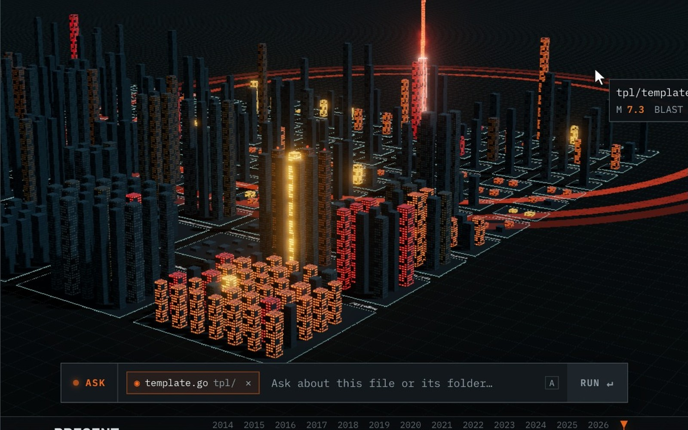

Folders become districts and files become towers: **height = how much depends on it, glow = magnitude**. **Click any building** and a beam fires from it while shockwave rings roll across the ground, igniting every tower that depends on it. Above is [hugo](https://github.com/gohugoio/hugo) (537 Go files): click `tpl/template.go` and **181 towers light up**.

<table>
<tr>
<td width="50%">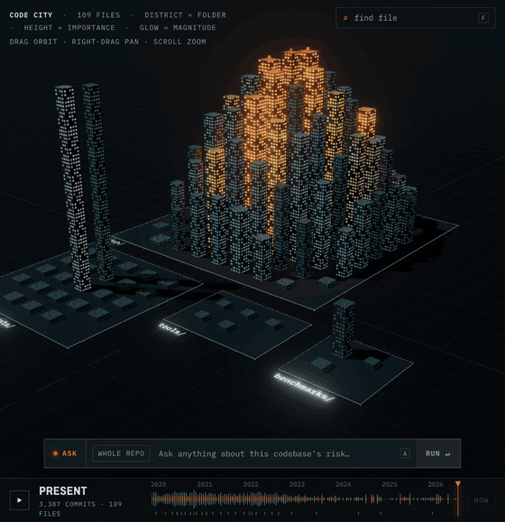</td>
<td width="50%">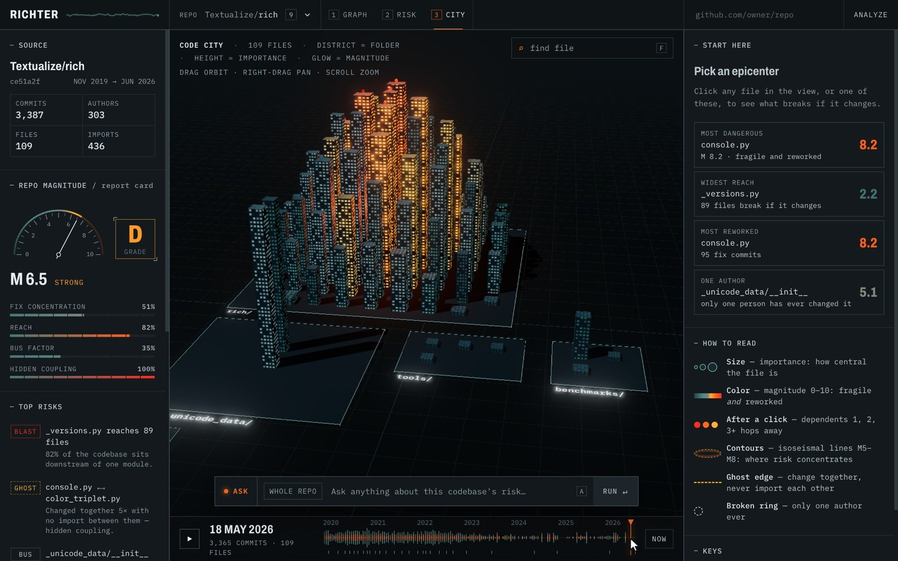</td>
</tr>
<tr>
<td><b>Time-travel.</b> Drag the seismogram timeline to replay the repo's history (28 snapshots, each scored by the same engine) and watch the hotspots form. Rich grows from 25 files in 2019 to 109 today.</td>
<td><b>Seven repos to explore</b> in the <a href="https://asil-eng.github.io/richter/app/">live demo</a>, including the large hugo and excalidraw cities. Press <code>3</code> for the city and <code>X</code> for full screen.</td>
</tr>
</table>

### 7 · A report card for the whole repo, in any language

<table>
<tr>
<td width="32%">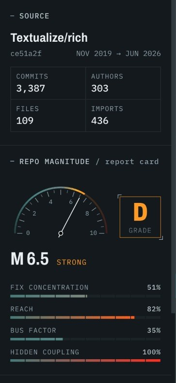</td>
<td width="68%">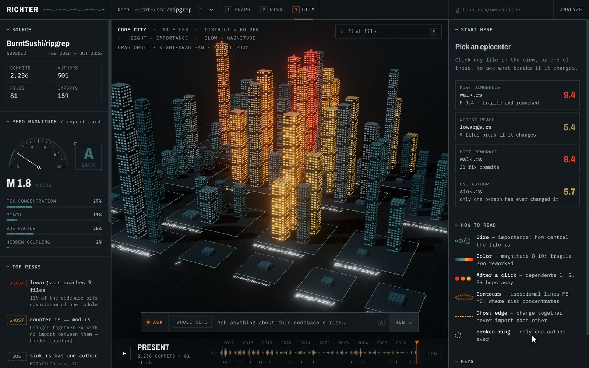</td>
</tr>
<tr>
<td>Grade and magnitude from four <i>absolute</i> signals: fix concentration, reach, bus factor, hidden coupling.</td>
<td><a href="https://github.com/BurntSushi/ripgrep">ripgrep</a>, in Rust. The riskiest files are the directory walker and gitignore engine: <code>walk.rs</code> scores M 9.4 (84 commits, 21 fixes, 31 authors).</td>
</tr>
</table>

Paste any public GitHub URL into **ANALYZE**. Switch between analyzed repos with the searchable picker (`/`).

---

## 🔍 Analyze any GitHub repo

The live demo ships with seven preloaded repos. To analyze **your own** (or any public repo), run Richter locally ([setup below](#-run-it)), then:

1. **Paste the repo link** into the box at the top-right of the app (`github.com/owner/repo`) and press **ANALYZE**.
   Any form works: `https://github.com/pallets/flask`, `github.com/pallets/flask`.
2. **Watch it work.** The box shows each stage: **CLONE** (download the full history) → **HISTORY** (read every commit) → **SCORE** (build the import graph and score every file). Small repos take seconds; a few thousand commits take a few minutes.
3. **Explore.** The repo opens automatically and is added to the **REPO** picker (press `/` to switch). Click any file to see its blast radius, press `3` for the city.
4. **Optional:** for time-travel, precompute its history snapshots:
   ```bash
   cd backend && .venv/bin/python -m richter.cli snapshots https://github.com/owner/repo
   ```
   With `OPENAI_API_KEY` set in `.env`, guard notes and questions work for the new repo too.

Prefer the terminal? `cd backend && .venv/bin/python -m richter.cli analyze https://github.com/owner/repo` does the same thing.

**Good to know:** the repo must be **public**; it must use one of the [supported languages](#-languages); repos with very long histories (e.g. VS Code's ~130,000 commits) are too large to analyze locally. In the hosted demo the ANALYZE box links here instead, because GitHub Pages can't run the analysis server.

---

## 🆚 What's different

Code visualizers already exist. Richter's bet is that **structure and history only become useful together**, and only if they answer *"what happens if I change this?"*

| | Dependency-graph tools<br><sub>pydeps, madge, dependency-cruiser</sub> | Hotspot / change-coupling tools<br><sub>CodeScene, code-maat</sub> | Code-city & history visualizers<br><sub>CodeCity, Gource</sub> | **Richter** |
| --- | :---: | :---: | :---: | :---: |
| Import / dependency structure | ✅ | ◐ | ◐ | ✅ |
| Git history: churn, fixes, authors | — | ✅ | ◐ | ✅ |
| **Transitive blast radius** of one file, by hop | ◐ | ◐ | — | ✅ |
| Change coupling with no import between files | — | ✅ | — | ✅ |
| One fused 0–10 risk score per file and per repo | — | ◐ | — | ✅ |
| Plain-English notes grounded in the file's metrics | — | ◐ | — | ✅ |
| Open source, demo runs offline in the browser | ✅ | ◐ | ✅ | ✅ |

<sub>✅ yes · ◐ partially, or depends on the tool · — no. Compiled from each project's public docs; corrections welcome.</sub>

## 🛡 Why you can trust the numbers

- **The scoring was frozen before it was tested.** `SCORING_VERSION = "1.0"` was locked after one sanity check, then backtested on four repos. It was never tuned to the results.
- **Results are published even when they're unflattering.** On ripgrep, Richter predicted future fixes no better than random. That result [is in the table](#-backtest-does-it-predict-anything).
- **The AI can't invent files.** Every path an answer mentions is checked against the real repo before it's highlighted; invented ones are dropped and counted.
- **Every number is reproducible.** `analyze`, `snapshots`, `notes` and `backtest` are CLI commands; the demo data in this repo is exactly what they produce.
- **The heat map can't exaggerate.** Contours reach M8 only around files that really are M8. An earlier version that inflated dense clusters was caught and fixed.
- **It's tested.** 19 backend tests cover the parsers (including per-language import resolution), the risk engine, snapshots and the AI guard rails.

## 👥 Who it's for

| When you're… | Richter tells you… |
| --- | --- |
| **About to change a file** | whether it's an M8 file with 88 dependents, and which of them to test |
| **New to a codebase** | where the dragons are before you write your first line |
| **Planning a refactor** | which files sit in the *danger zone*: central **and** constantly reworked |
| **Managing a team** | which risky files only one person has ever touched (bus factor) |
| **Paying down tech debt** | where fixes keep landing, ranked by how far a change would reach |

---

## 🧮 How the score works

Two questions per file, combined so that only files bad at **both** run hot:

> **magnitude = √( structural × human )**  ·  *structural*: how much depends on it  ·  *human*: how often it gets reworked

<details>
<summary><b>Exact definitions</b> (all in <a href="backend/richter/risk.py"><code>backend/richter/risk.py</code></a>, pure functions)</summary>

<br>

| Signal | Definition |
| --- | --- |
| **importance** | PageRank on the import graph, rank-normalized |
| **blast radius** | Reverse-import reachability: every file that depends on this one, directly or transitively, with hop distance |
| **structural** | `0.5·rank(PageRank) + 0.5·rank(blast radius size)` |
| **human** | `churn × fix_ratio`, log-scaled. `fix_ratio = (fixes + 1) / (churn + 5)` is smoothed, so a file with one commit that happened to be a fix doesn't score 100%. In effect it's a smoothed count of fix commits: high only for files that are both busy *and* repeatedly reworked. |
| **magnitude** | `sqrt(max(structural, 0.05) · max(human, 0.05))`. This geometric mean only runs hot when a file is fragile *and* reworked. The floor keeps a visible gradient. |
| **bus factor** | A separate flag for files only one author has ever touched |

**Co-change** (ghost edges) is de-noised: commits touching more than 30 files are skipped, and a pair needs at least 3 shared commits that make up at least 50% of the less-edited file's commits. File identity follows renames (`git log -M`).

**The repo grade** uses four *absolute* signals (fix concentration, widest blast radius, bus-factor share, hidden-coupling density), because file magnitudes are relative within a repo and couldn't tell repos apart.

The scoring was **frozen** (`SCORING_VERSION = "1.0"`) after one sanity check: are fastapi's hottest files really the dangerous ones? `routing.py` ranks #1 and `dependencies/utils.py` #4, alongside `encoders.py`, `params.py` and `exceptions.py`. The bottom five are re-export stubs.

</details>

### What it found

| Repo | Grade | Most dangerous file | Notable |
| --- | --- | --- | --- |
| [Textualize/rich](https://github.com/Textualize/rich) · Python | **D** · M 6.5 | `rich/console.py` M 8.2: 467 commits, 95 fixes, 43 authors | A Unicode version table (`_unicode_data/_versions.py`) sits beneath 82% of the codebase |
| [psf/black](https://github.com/psf/black) · Python | **C** · M 5.4 | `src/black/__init__.py` M 8.4: 579 commits, 130 fixes, 173 authors | `pgen.py` ⟷ `pytree.py` changed together 10× with no import |
| [fastapi/fastapi](https://github.com/fastapi/fastapi) · Python | **B** · M 4.5 | `fastapi/routing.py` M 7.8: 193 commits, 50 fixes, 54 authors | 61% of all fix touches land in the hottest 10% of files |
| [BurntSushi/ripgrep](https://github.com/BurntSushi/ripgrep) · Rust | **A** · M 1.8 | `crates/ignore/src/walk.rs` M 9.4: 84 commits, 21 fixes, 31 authors | Risk is concentrated in one crate (`ignore`); the rest is calm |
| [excalidraw/excalidraw](https://github.com/excalidraw/excalidraw) · TypeScript · 529 files | **B** · M 4.4 | `App.tsx` M 7.6: 358 fix commits | Change `types.ts` and 421 files (80%) are downstream; `App.tsx` ⟷ `constants.ts` changed together 84× with no import |
| [gohugoio/hugo](https://github.com/gohugoio/hugo) · Go · 537 files | **B** · M 3.5 | `tpl/template.go` M 7.3 | 7,687 import links; `compare.go` reaches 330 files (62%) |
| [Textualize/textual](https://github.com/Textualize/textual) · Python · 249 files | **B** · M 4.1 | `src/textual/geometry.py` M 7.9 | `widget.py`, `app.py`, `screen.py` and `dom.py` each reach 170 files |

---

## 📉 Backtest: does it predict anything?

We score each repo as it was 60% of the way through its history, then count the fix commits that landed **afterwards** and measure what share hit the top 10% of files by magnitude.

| Repo | Scored at | Later fix touches | Top 10% by **magnitude** | Top 10% by churn alone | Random |
| --- | --- | --- | --- | --- | --- |
| rich | commit 2,056 / 3,387 | 208 | **45%** | 46% | 10% |
| fastapi | commit 4,816 / 7,932 | 76 | **68%** | 72% | 10% |
| black | commit 1,483 / 2,442 | 233 | **42%** | 48% | 11% |
| ripgrep | commit 1,358 / 2,236 | 173 | **11%** | 17% | 11% |

**The honest reading:**
- On the three Python repos, magnitude finds where future fixes land **4–7× better than random**.
- A churn-only ranking does about as well, so the *predictive* power comes mostly from history.
- On ripgrep neither ranking beat random: later fixes landed in files that were quiet at the cutoff.

What magnitude adds is **impact**: among reworked files, it ranks the ones whose changes reach furthest, and the blast radius shows exactly where. The scoring was frozen before this test and never tuned against it. Reproduce it with `python -m richter.cli backtest <url>`.

---

## 🌐 Languages

Only the import parser is language-specific. Git history, scoring, AI notes and all three views work the same way everywhere.

<details>
<summary><b>How each language's imports become edges</b></summary>

<br>

| Language | How an import becomes an edge |
| --- | --- |
| **Python** | `ast`: relative imports, `src/` layouts, `__init__.py` re-exports resolved to the real module |
| **JavaScript / TypeScript** (`.js .jsx .ts .tsx .mjs .vue .svelte`) | relative paths, `index` files, `./x.js` → `x.ts`, `tsconfig`/`jsconfig` path aliases, monorepo workspace packages |
| **Go** | module path from `go.mod`; an import links to every file in that package |
| **Java / Kotlin / Scala** | `package` + class → file; wildcard imports → the whole package |
| **Rust** | `mod` declarations, `use crate::/super::/self::`, `{a, b}` groups, workspace crates |
| **C / C++ / Objective-C** | `#include` relative to the file, then by unique path suffix |
| **C#** | `using` → the type, or the files declaring that namespace |
| **Ruby** | `require_relative`, gem-style `require` → `lib/<name>.rb` |
| **PHP** | `use` namespace\class → file, `require`/`include` |

Verified on real repos ([zustand](https://github.com/pmndrs/zustand), [fzf](https://github.com/junegunn/fzf), [gson](https://github.com/google/gson), [ripgrep](https://github.com/BurntSushi/ripgrep), [hiredis](https://github.com/redis/hiredis), [sinatra](https://github.com/sinatra/sinatra), [guzzle](https://github.com/guzzle/guzzle)) by spot-checking sampled edges against the source. Tests, docs, examples, vendored code and build output are excluded by default (`--include-tests` brings tests, docs and examples back).

</details>

---

## 🏗 Architecture

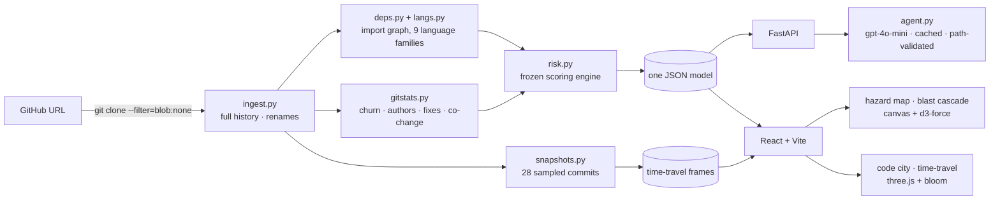

- **Full history, fast.** A *blobless* clone keeps every commit but skips file contents until they're needed. A shallow clone would make churn, authorship and co-change meaningless.
- **One model, every view.** The backend writes a single JSON model. The 2D map, the 3D city, the inspector and the AI all read the same numbers.
- **Offline demo.** The seven demo repos ship with their models, snapshots and precomputed AI notes, so the app runs from static files with no backend and no API key.
- **Honest AI.** Prompts contain only the selected file's metrics, its dependents and a short code excerpt. Answers are cached, and file paths are validated against the repo before they're highlighted.

---

## 🚀 Run it

```bash
# backend · Python 3.11+ (tested on 3.14)
cd backend
python3 -m venv .venv && .venv/bin/pip install -r requirements.txt
.venv/bin/uvicorn richter.api:app --port 8000

# frontend · Node 20.19+ (tested on 24), in a second terminal
cd frontend && npm install && npm run dev        # → http://localhost:5173
```

Optional: `cp .env.example .env` and set `OPENAI_API_KEY` for live AI notes and free-form questions. Without a key, the demo repos still show their precomputed AI notes.

The hosted demo is the same frontend built in static mode: `frontend/scripts/build-pages.sh` writes it to `docs/app/` using only the committed demo data.

```bash
cd backend
.venv/bin/python -m richter.cli analyze   https://github.com/owner/repo [--include-tests]
.venv/bin/python -m richter.cli snapshots https://github.com/owner/repo   # time-travel frames
.venv/bin/python -m richter.cli notes     https://github.com/owner/repo   # precompute AI notes (needs key)
.venv/bin/python -m richter.cli backtest  https://github.com/owner/repo   # needs snapshots
.venv/bin/python -m pytest -q                                              # 19 tests
```

| Key | Action |
| --- | --- |
| `1` `2` `3` | graph · risk map · code city |
| `F` | find a file |
| `A` | ask the repo |
| `/` | switch repo |
| `X` | full screen |
| `Esc` | clear selection |

---

## Scope and limitations

- **Outside Python, import parsing is pattern-based, not a compiler.** Java/Kotlin/Scala/C# files can use same-package types without an import, and those links are invisible. Go and C# links are package/namespace-level. Swift and Dart aren't parsed yet. A [tree-sitter](https://tree-sitter.github.io) front end would make extraction more robust; everything after the parser is already language-agnostic.
- **Fix detection** is a regex over commit messages (`fix`, `bug`, `revert`, `hotfix`, `regression`, `crash`, `broken`).
- **Importance only counts imports inside the repo**, so a library's public entry points look less central than they are.
- **Only source code is mapped.** Folders holding only assets, data or compiled caches (PDFs, images, `__pycache__`) don't appear in the city.
- **The map is a layout, not a geography.** Contours show where risky files cluster in the import graph; distance has no meaning beyond that.
- **First ingest** of a large repo is slow (about 4 minutes for fastapi's 7,932 commits), because rename detection fetches file contents on demand. Later runs reuse the clone.
- **Free-form AI questions need `OPENAI_API_KEY`.** Selection-aware questions always go to the live API.
- The demo video's narration is an AI-generated voice ([ElevenLabs](https://elevenlabs.io)); the music bed is synthesized.

---

## 🗺 What's next

These aren't built yet:
- **A GitHub Action** that comments on pull requests: *"this PR touches 3 files above M7; 112 files downstream."*
- **[tree-sitter](https://tree-sitter.github.io) parsers**, for exact imports in every language plus Swift and Dart.
- **Risk thresholds in CI:** fail a build when a change pushes a file into the danger zone.
- **Per-function blast radius** inside large files.

---

## Hackathon project overview

- **Project name:** Richter — measure the magnitude of risk in any codebase
- **Short description:** Richter ingests a public GitHub repo and predicts what breaks when you change a file (blast radius), where work keeps getting reworked (fix-heavy churn), and which files are secretly coupled (co-change with no import link). It fuses these into one magnitude score shown as a seismic hazard map and a 3D code city with time-travel, and writes guard notes and unblock plans with an LLM. It helps engineers and reviewers touch risky code safely.
- **Team:** Muhammed Asil Pari ([@asil-eng](https://github.com/asil-eng))
- **Working demo:** Live at **https://asil-eng.github.io/richter/app/** (static build, seven demo repos, cached AI). Video: https://asil-eng.github.io/richter/. Full app locally: see [Run it](#-run-it).
- **Technology stack:** Python 3 + FastAPI, GitPython, `ast` + per-language import resolvers, networkx (backend); React 19 + Vite + TypeScript, d3-force, three.js (frontend); OpenAI `gpt-4o-mini` (notes, ask-the-repo).

### Run the project

1. Prerequisites and versions: Python 3.11+ (tested on 3.14), git 2.30+, Node 20.19+ (tested on 24)
2. Dependency installation: `cd backend && python3 -m venv .venv && .venv/bin/pip install -r requirements.txt` and `cd frontend && npm install`
3. Environment setup: `cp .env.example .env` and set `OPENAI_API_KEY` (only needed for live AI notes and free-form questions)
4. Start the project: `cd backend && .venv/bin/uvicorn richter.api:app --port 8000`, then `cd frontend && npm run dev` → http://localhost:5173
5. Run checks or tests: `cd backend && .venv/bin/python -m pytest -q`; `cd frontend && npm run build && npx oxlint src`

### Current status

- Working features: blobless ingest with full history; import graphs for Python, JS/TS, Go, Java/Kotlin/Scala, Rust, C/C++, C#, Ruby, PHP; git stats and de-noised co-change; frozen risk engine; FastAPI; seismic hazard map with blast-radius cascade; risk map; ghost-edge and bus-factor layers; explanatory inspector; report card; 3D code city with time-travel; selection-aware ask-the-repo with path validation; guard notes and unblock plans (AI path verified with `gpt-4o-mini`, rule-based fallback verified); searchable repo picker; file finder; backtest CLI.
- Known limitations: see [Scope and limitations](#scope-and-limitations).
- Libraries, APIs, and public datasets used: [FastAPI](https://fastapi.tiangolo.com), [GitPython](https://github.com/gitpython-developers/GitPython), [networkx](https://networkx.org), [NumPy](https://numpy.org)/[SciPy](https://scipy.org) (PageRank), [React](https://react.dev), [Vite](https://vite.dev), [d3-force](https://d3js.org/d3-force), [three.js](https://threejs.org), [IBM Plex Mono](https://github.com/IBM/plex) and [Archivo](https://github.com/Omnibus-Type/Archivo) via Fontsource, [OpenAI API](https://platform.openai.com) (chat), [ElevenLabs](https://elevenlabs.io) (demo narration). Demo data is derived from the public repositories [Textualize/rich](https://github.com/Textualize/rich), [fastapi/fastapi](https://github.com/fastapi/fastapi), [psf/black](https://github.com/psf/black) and [BurntSushi/ripgrep](https://github.com/BurntSushi/ripgrep).

See [AI_USAGE.md](AI_USAGE.md) for AI assistance and [CHANGELOG.md](CHANGELOG.md) for the development record.

## Event: Devin Hack Kochi

Adapted from the [original documentation template](https://github.com/anima-regem/devday-kochi-hackathon-template), which the organizer shared by mistake. Follow current organizer announcements for event logistics and eligibility.

**[Event guidance](RULES.md)** · **[Agent instructions](AGENTS.md)** · **[Submission](SUBMISSION.md)**

Devin Hack Kochi has no major AI usage constraints. Participants may use Devin and other AI tools, models, and providers; this template does not require Codex or restrict AI usage to OpenAI. AI usage notes are project documentation, not an additional event eligibility requirement.

See [RULES.md](RULES.md) for the corrected event guidance.
