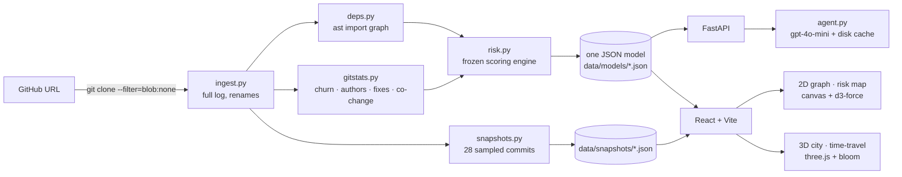

# Richter

**Measure the magnitude of risk in any codebase.**

Richter reads a GitHub repo's import graph and its whole git history. It shows which files break other code when you change them, where work keeps getting redone, and which files are linked in ways the code doesn't show. It combines these into one **magnitude** score, the way the Richter scale summarizes an earthquake.


<sub>Clicking `rich/cells.py`. 88 files (81% of the codebase) depend on it, directly or through other files. The ring of files that import it directly lights up first, then the files that import those, and so on.</sub>

## What it does that a map doesn't

Tools for visualizing code already exist ([CodeScene](https://codescene.com)'s hotspot analysis, [CodeCity](https://wettel.github.io/codecity.html), [Gource](https://gource.io)). Richter goes further: it **predicts the blast radius** of a change and **tells you what to do about it**.

- **Blast-radius cascade.** Click any file and Richter follows the imports *backwards* through the whole graph: every file that depends on it, directly or through other files. The result plays out as an animated shockwave, colored by how many import hops each dependent is away (red → orange → amber).
- **Guard notes and unblock plans.** For any file, an LLM (`gpt-4o-mini`) writes a short note: *"touch carefully: here's what breaks and why"* or *"why this keeps getting reworked, and how to unblock it."* The note is based only on that file's metrics, the files that depend on it, and a short code excerpt. These are notes, not code. Responses are cached on disk, and the demo repos ship precomputed AI notes for their 14 riskiest files, so the demo shows real AI output even without a key. For any other file, no key means a clearly labelled rule-based note instead.
- **Time-travel.** Scrub through the repo's whole history and watch the 3D city grow and redden as rework builds up. The demo repos have 28 precomputed snapshots, each scored by the same engine.
- **Ghost edges (hidden coupling).** These are pairs of files that are repeatedly committed together but never import each other. In fastapi, the `security/*` modules (`api_key.py`, `oauth2.py`, `http.py`, `open_id_connect_url.py`) changed together up to 17 times with no import between them.


## Two views of one model

| Risk map | Code city |
| --- | --- |
|  |  |
| Files as nodes (size = importance), imports as edges, color = magnitude. The dashed amber arcs are ghost edges. | Folders become districts and files become towers. Height = importance, glow = magnitude. The five most dangerous towers get blinking red beacons. |

Both views read the **same JSON model**, so selecting a file, highlighting it, and the layer toggles all behave the same way in both.

## How the score works

All the scoring lives in one isolated module of pure functions, [`backend/richter/risk.py`](backend/richter/risk.py):

| Signal | Definition |
| --- | --- |
| **importance** | PageRank on the import graph, rank-normalized |
| **blast radius** | Reverse-import reachability: every file that depends on this one, directly or transitively, with hop distance |
| **structural** | `0.5·rank(PageRank) + 0.5·rank(blast radius size)` |
| **human** | `churn × fix_ratio`, log-scaled. `fix_ratio = (fixes + 1) / (churn + 5)` is smoothed, so a file with one commit that happened to be a fix doesn't score 100%. In practice this is a smoothed count of fix commits: it's high only for files that are both busy *and* repeatedly reworked. |
| **magnitude** | `sqrt(max(structural, 0.05) · max(human, 0.05))`. This geometric mean only runs hot when a file is both fragile *and* reworked. The floor keeps a visible gradient instead of zeroing every file that is weak on one axis. |
| **bus factor** | A separate flag for files only one author has ever touched |

Co-change (the ghost edges) is filtered to cut noise. Commits touching more than 30 files are skipped. A pair needs at least 3 shared commits, and those shared commits must make up at least 50% of the commits on the less-edited file. File identity follows renames (`git log -M`).

The scoring was **frozen** (`SCORING_VERSION = "1.0"`) after one sanity check on fastapi: are the hottest files really the dangerous ones? They are: `routing.py` ranks #1 and `dependencies/utils.py` #4, alongside `encoders.py`, `params.py` and `exceptions.py`. The bottom five are re-export stubs that contain almost no code.

### What it found in the demo repos

| Repo | Report card | Most dangerous file | Notable |
| --- | --- | --- | --- |
| [Textualize/rich](https://github.com/Textualize/rich) | **D**, M 6.5 (strong) | `rich/console.py`, M 8.2: 467 commits, 95 fixes, 43 authors | A Unicode version table (`_unicode_data/_versions.py`) sits beneath 82% of the codebase |
| [psf/black](https://github.com/psf/black) | **C**, M 5.4 (moderate) | `src/black/__init__.py`, M 8.4: 579 commits, 130 fixes, 173 authors | `pgen.py` ⟷ `pytree.py` changed together 10× with no import between them |
| [fastapi/fastapi](https://github.com/fastapi/fastapi) | **B**, M 4.5 (light) | `fastapi/routing.py`, M 7.8: 193 commits, 50 fixes, 54 authors | 61% of all fix touches land in the hottest 10% of files |

The repo grade comes from four *absolute* signals (fix concentration, widest blast radius, bus-factor share, hidden-coupling density). File magnitudes are relative within a repo, so a grade built from them alone couldn't tell repos apart.

### Backtest: does it predict anything?

The backtest scores each repo as it was 60% of the way through its history, using that moment's snapshot. It then counts the fix commits that landed **afterwards** and measures what share of them hit the top 10% of files by magnitude:

| Repo | Scored at | Fix touches after | Top 10% by **magnitude** | Top 10% by churn alone | Random |
| --- | --- | --- | --- | --- | --- |
| rich | commit 2,056 / 3,387 | 208 | **45%** | 46% | 10% |
| fastapi | commit 4,816 / 7,932 | 76 | **68%** | 72% | 10% |
| black | commit 1,483 / 2,442 | 233 | **42%** | 48% | 11% |

The honest reading: magnitude finds where future fixes land **4–7× better than random**. A churn-only ranking does about as well, and slightly better on fastapi and black. So the *predictive* power comes mostly from the history signal. What magnitude adds is **impact**: it ranks the reworked files by how much breaks when they change, and the blast radius tells you exactly what that is. The scoring was frozen before this test and hasn't been tuned against it. Reproduce it with `python -m richter.cli backtest <url> [--cutoff 0.6]`.

## Architecture



- **Ingest:** a blobless clone keeps the *full* commit history while skipping file contents until they're needed. A shallow clone would make churn, authorship and co-change meaningless.
- **Import parsing:** handles relative imports, `src/` layouts and `__init__.py` re-exports, so edges point at the real module. Otherwise everything collapses into a star centered on `__init__.py` (on fastapi, 2% of edges end at an `__init__.py`). `tests/`, `docs_src/`, `docs/` and `examples/` are excluded by default; add `--include-tests` to include them.
- **Ask-the-repo:** the model must return JSON `{answer, files[]}`, and every path is checked against the model before anything gets highlighted. Invented paths are dropped, and the UI says how many were dropped.
- **Offline demo:** the three demo models and their snapshots are committed. The frontend loads them as static files, so the demo runs without the backend or an API key.

## Run it

```bash
# backend (Python 3.11+, tested on 3.14)
cd backend
python3 -m venv .venv && .venv/bin/pip install -r requirements.txt
.venv/bin/uvicorn richter.api:app --port 8000

# frontend (Node 20.19+, tested on 24) in a second terminal
cd frontend && npm install && npm run dev      # → http://localhost:5173
```

Optional: `cp .env.example .env` and set `OPENAI_API_KEY` to enable AI guard notes, unblock plans and ask-the-repo.

```bash
# analyze any public Python repo, then precompute its time-travel frames
cd backend
.venv/bin/python -m richter.cli analyze https://github.com/owner/repo [--include-tests]
.venv/bin/python -m richter.cli snapshots https://github.com/owner/repo
.venv/bin/python -m richter.cli notes https://github.com/owner/repo      # precompute AI notes (needs key)
.venv/bin/python -m richter.cli backtest https://github.com/owner/repo   # needs snapshots
.venv/bin/python -m pytest -q                  # 12 tests
```

Keys: `1` graph · `2` risk map · `3` city · `Esc` clear selection.

## Scope and limitations

- **Works on Python today.** Import parsing uses Python's `ast` module. Everything after the parser is language-agnostic (graph, git stats, scoring, views), so other languages need only a new import parser, for example one built on [tree-sitter](https://tree-sitter.github.io).
- **AI notes need a key for anything outside the bundle.** The demo repos include precomputed `gpt-4o-mini` notes (14 files each) and answers to the three suggested questions. Other files fall back to a labelled rule-based note, and free-form questions need `OPENAI_API_KEY`.
- **Fix detection** is a regex over commit messages (`fix`, `bug`, `revert`, `hotfix`, `regression`, `crash`, `broken`).
- **Importance only counts imports inside the repo.** A library's public entry points look less central than they really are, because their callers live outside the repo.
- **First ingest** of a large repo is slow (about 4 minutes for fastapi's 7,932 commits), because rename detection fetches file contents on demand. Later runs reuse the clone.
- Snapshots skip files that only ever appeared through merge commits (the log is read with `--no-merges`).
- Visuals were checked with headless Chrome using software WebGL. Bloom on a real GPU may look slightly stronger.

---

## Hackathon project overview

- **Project name:** Richter — measure the magnitude of risk in any codebase
- **Short description:** Richter ingests a public GitHub repo and predicts what breaks when you change a file (blast radius), where work keeps getting reworked (fix-heavy churn), and which files are secretly coupled (co-change with no import link). It fuses these into one magnitude score and writes guard notes and unblock plans with an LLM. It helps engineers and reviewers touch risky code safely.
- **Team:** Muhammed Asil Pari ([@asil-eng](https://github.com/asil-eng))
- **Working demo:** Local; see [Run it](#run-it). The demo repos load without the backend or an API key.
- **Technology stack:** Python 3 + FastAPI, GitPython, `ast`, networkx (backend); React 19 + Vite + TypeScript, d3-force, three.js (frontend); OpenAI `gpt-4o-mini` (notes).

### Run the project

1. Prerequisites and versions: Python 3.11+ (tested on 3.14), git 2.30+, Node 20.19+ (tested on 24)
2. Dependency installation: `cd backend && python3 -m venv .venv && .venv/bin/pip install -r requirements.txt` and `cd frontend && npm install`
3. Environment setup: `cp .env.example .env` and set `OPENAI_API_KEY` (only needed for AI notes and ask-the-repo)
4. Start the project: `cd backend && .venv/bin/uvicorn richter.api:app --port 8000`, then `cd frontend && npm run dev` → http://localhost:5173
5. Run checks or tests: `cd backend && .venv/bin/python -m pytest -q`; `cd frontend && npm run build && npx oxlint src`

### Current status

- Working features: ingest, import + git parsers, risk engine, JSON model, FastAPI, 2D graph with blast-radius cascade, risk map, ghost-edge and bus-factor layers, report card, 3D code city, time-travel (precomputed for rich, fastapi, black), ask-the-repo with path validation, guard notes and unblock plans (AI path verified with gpt-4o-mini; rule-based fallback verified).
- Known limitations: see [Scope and limitations](#scope-and-limitations).
- Libraries, APIs, and public datasets used: [FastAPI](https://fastapi.tiangolo.com), [GitPython](https://github.com/gitpython-developers/GitPython), [networkx](https://networkx.org), [NumPy](https://numpy.org)/[SciPy](https://scipy.org) (PageRank), [React](https://react.dev), [Vite](https://vite.dev), [d3-force](https://d3js.org/d3-force), [three.js](https://threejs.org), [IBM Plex Mono](https://github.com/IBM/plex) and [Archivo](https://github.com/Omnibus-Type/Archivo) via Fontsource, [OpenAI API](https://platform.openai.com). Demo data is derived from the public repositories [Textualize/rich](https://github.com/Textualize/rich), [fastapi/fastapi](https://github.com/fastapi/fastapi) and [psf/black](https://github.com/psf/black).

See [AI_USAGE.md](AI_USAGE.md) for AI assistance and [CHANGELOG.md](CHANGELOG.md) for the development record.

## Event: DevDay Exchange Community Hackathon, Kochi

Built from the [event template](https://github.com/anima-regem/devday-kochi-hackathon-template). **[Event rules](RULES.md)** · **[Agent instructions](AGENTS.md)** · **[Submission](SUBMISSION.md)** · **[Luma](https://luma.com/z10nz8gp)**

| Detail | Information |
| --- | --- |
| Venue | JAIN University, Kochi, rooms 2008 and 2009 |
| Dates | 10–11 October 2026 (wrap-up by 10:00 AM IST, 11 October) |
| Participation | Solo or a team of up to 4 participants |
| Theme | Open |
